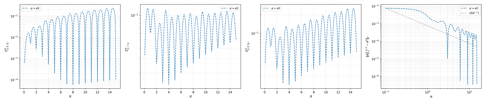
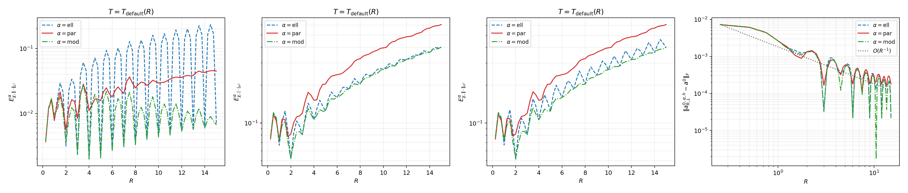
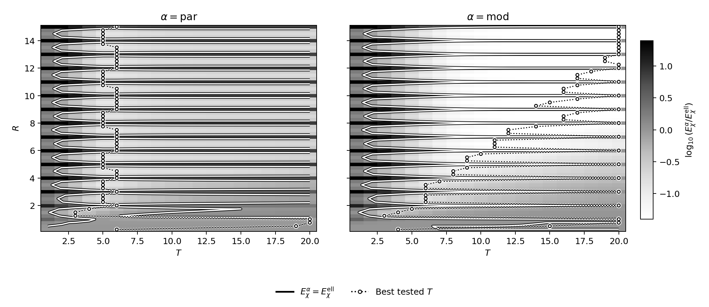
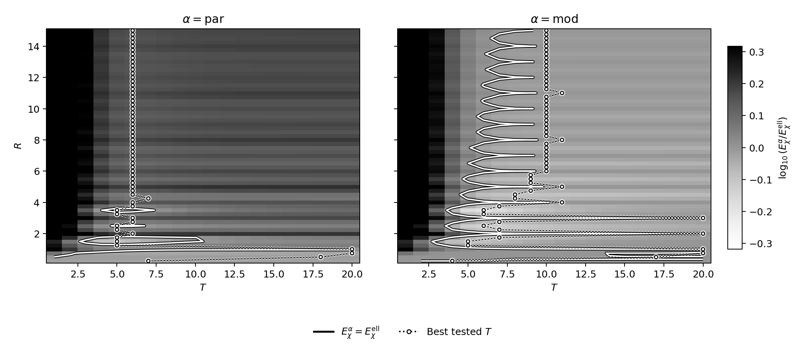
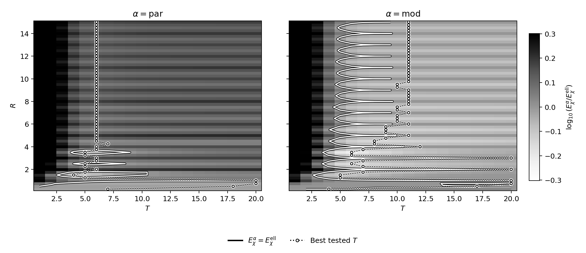
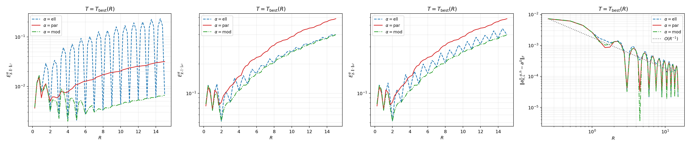

\newcommand{\R}{\mathbb{R}}
\newcommand{\Rd}{\mathbb{R}^{d}}
\newcommand{\Rdd}{\mathbb{R}^{d \times d}}
\newcommand{\Div}{\nabla \cdot}

## Infinite Domain Problem
In this section, consider the elliptic PDE on the unbounded domain
$$
    -\Div a \nabla u = g \quad \text{in } \Rd,
$$
where $a:\Rd \to \Rdd$ is uniformly elliptic. 

We truncate the infinite domain $\Rd$ into a finite domain as
$$
    \begin{cases}
       -\nabla \cdot a \nabla u_R
           = g & \text{in } K_R=(-R/2, R/2)^d, \\
       u_R = 0 & \text{on } \partial K_R.
    \end{cases}
$$
We introduce $u_{R, T}=\int_0^T w_R(t, x)\,dt$ where $w_R$ solves the parabolic equation
$$
    \begin{cases}
       \partial_t w_R(t, x)-\nabla \cdot a(x) \nabla w_R(t, x)
           = 0 & (t, x) \in (0, T] \times K_R, \\
       w_R(0 ,x) = g(x) &  x\in K_R,\\
       w_R(t, x) = 0    & (t, x) \in (0, T] \times \partial K_R.
    \end{cases}
$$
Observe that $u_{R, T}$ solves
$$
-\nabla \cdot a \nabla u_{R, T}=g - e^{-T\mathcal{A}}g \quad \text{in } K_R,
$$
where $\mathcal{A}:= \nabla \cdot a \nabla$ and $e^{-T\mathcal{A}}g(x) = w_R(T, x)$. 

## Cell Problems
Consider $a:\Rd \to \Rdd$ is $K=(-1/2, 1/2)^d$-periodic. From the homogenization theory, we have the cell problems
$$
    \begin{cases}
       -\nabla \cdot a \nabla \chi_j
           = g_j  \quad \text{ in } \Rd, \\
       \chi_j \text{ is } K\text{-peroidic}, \int_K \chi_j = 0.
    \end{cases}
$$
where $g_j=\nabla \cdot a e_j$ for $e_j\in \Rd$.

## Numerical Experiments

### Homogenization Theory
Consider the periodic coefficient $a:\R^2 \to \R ^{2\times 2}$
$$
a(x)=\frac{1}{8\pi^2}\begin{pmatrix}\dfrac{2}{2+\cos(2\pi x_1)}&0\\0&1+\dfrac12\cos(2\pi x_1)\end{pmatrix}.
$$
Correctors are
$$
\chi_1(x) = \frac{1}{4\pi} \sin(2\pi x_1),\quad \chi_2(x)=0.
$$
Homogenized coefficient is
$$
a^0 = \frac{1}{8\pi ^2} I_{2\times 2}.
$$

### Error Norms
$$
E^{\alpha}_{\,\lvert \cdot \rvert_{H^1},\,R,\,L}=\sum_{\tau \in \mathcal{T}^h(K_R)} \sum_{j=1}^d \int_{\tau \cap K_L} \lvert \nabla\chi_j - \nabla\chi_{j, R} \rvert^2  
$$
$$
E^{\alpha}_{\,\| \cdot \|_{L^2},\,R,\,L}=\sum_{\tau \in \mathcal{T}^h(K_R)} \sum_{j=1}^d \int_{\tau \cap K_L} \lvert \chi_j - \chi_{j, R} \rvert^2  
$$
$$
E^{\alpha}_{\,\| \cdot \|_{H^1},\,R,\,L} = \sqrt{
    \big(E^{\alpha}_{\,\| \cdot \|_{L^2},\,R,\,L}
    \big)^2 +
    \big(E^{\alpha}_{\,\lvert \cdot \rvert_{H^1},\,R,\,L}
    \big)^2
    }
$$

$$
e_i\cdot a^0_{R, L} e_j = \int_{K_L} e_i \cdot 
\big(a (e_j + \nabla \chi_{j, R})
\big)
$$

$$
E_{\mathrm{HMM}} = \|a^0 - a^0_{R, L}\|_F
$$

### Parameter Settings
- Windowing\/Oversampling size: $L = \frac{2}{3}R$. $R = (1+2\delta)L \iff \delta = \frac{\frac{R}{L} - 1}{2}=0.25.$
- Default time setting: $T= 2\pi \sqrt{\lambda \Lambda} \lvert R-L \rvert = 4\pi \lvert R-L \rvert = \frac{4}{3}\pi R$.

- Experiment 1:
  - $\alpha \in \{\mathrm{ell}\}$ 
  - $R \in \{0.1, 0.2, 0.3, \ldots, 15\}$
  - $h=2^{-7}$
  - 

- Experiment 2:
  - $\alpha \in \{\mathrm{ell},\mathrm{par}, \mathrm{mod} \}$ 
  - $R \in \{0.25, 0.5, 0.75, \ldots, 15\}$
  - $h=2^{-4}$
  - $T\in \{1, 2, 3, \ldots, 20\}$ for $\alpha \in \{\mathrm{par}, \mathrm{mod}\}$
  - $\Delta T = 0.25$ for $\alpha = \mathrm{par}$
  - 
  - 
  - 
  - 
  - 

